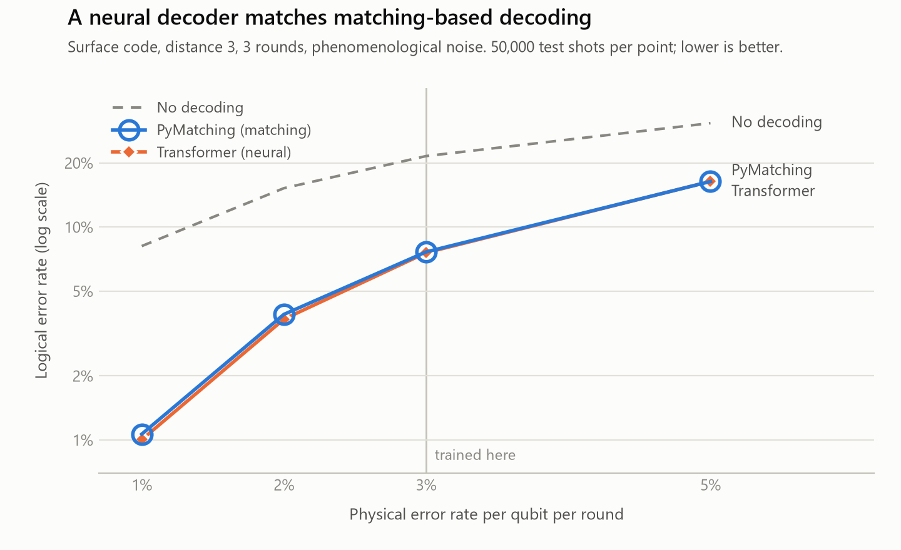

# Qubit Sentinel


Three AI projects around one question: **what does computing look like once quantum computers arrive?**

| Track | Question | AI part | Quantum part |
|---|---|---|---|
| [`qec`](#1-neural-decoder-for-the-surface-code-qec) | Can a neural network correct quantum errors as well as the standard algorithm? | Transformer decoder (PyTorch) | Surface code syndromes, PyMatching baseline |
| [`noise`](#2-circuit-fidelity-prediction-noise) | Can we predict how badly a circuit will run before spending hardware time on it? | Gradient-boosted regressor | Qiskit circuits on a simulated IBM device |
| [`pqc`](#3-post-quantum-crypto-scanner-pqc) | Which cryptography in a codebase will a quantum computer break, and what replaces it? | Optional Claude review of each finding | Shor-vulnerable crypto → NIST ML-KEM / ML-DSA / SLH-DSA |

Everything runs on a laptop CPU, through one command-line tool.

<picture>
  <source media="(prefers-color-scheme: dark)" srcset="docs/figures/qec_decoder_dark.png">
  
</picture>

## Results at a glance

- **Neural decoding:** on a distance-3 surface code, a transformer matches PyMatching's logical error rate within error bars, including at error rates it never trained on. PyMatching is still about 100× faster on CPU.
- **Fidelity prediction:** in simulation, the classic "expected success probability" heuristic is already near-perfect for mirror circuits (R² 0.98), and gradient boosting only ties it. ML helps modestly on raw output distributions (rank correlation 0.59 vs 0.51). The real test is real hardware, which is next.
- **Post-quantum scanning:** on the bundled demo app, the scanner finds 18 crypto uses across 4 languages plus config files. Of these, 13 are quantum-vulnerable and 3 already use post-quantum algorithms, and it flags the 1024-bit RSA key and a committed private key as critical.

## Quick start

```bash
git clone https://github.com/XxPacificxX/qubit-sentinel.git
cd qubit-sentinel
python -m venv .venv
# Windows: .venv\Scripts\activate    macOS/Linux: source .venv/bin/activate
pip install -e ".[dev]"

python -m pytest                              # 13 tests, ~10 s
python -m qailab scan examples/demo_app       # crypto scan, instant
python -m qailab noise --circuits 200         # fidelity model, ~1 min
python -m qailab qec --epochs 3               # neural decoder, a few minutes on CPU
python -m qailab report                       # collect everything into results/SUMMARY.md
```

**Optional extras:**
- `pip install -e ".[stim]"`: circuit-level noise for the decoder (otherwise it uses a built-in NumPy noise model).
- `pip install -e ".[llm]"`: Claude review in the scanner.
- `pip install -e ".[plot]"`: regenerate the figures.

## 1. Neural decoder for the surface code (`qec`)

```bash
python -m qailab qec --distance 3 --p 0.03 --eval-p 0.01 0.02 0.05
python -m qailab qec --distance 5 --p 0.02 --train-shots 1000000 --epochs 10   # harder, slower
```

- **Data:** detection events sampled from a distance-d rotated surface code memory experiment, with d rounds of noisy syndrome measurement. Noise is circuit-level via [Stim](https://github.com/quantumlib/Stim) when it is installed, and a NumPy phenomenological model (bit flips plus measurement errors) otherwise.
- **Model:** a transformer treats every detector as a token (whether it fired, plus its row, column and round) and predicts whether the logical qubit flipped.
- **Benchmark:** the same test shots go through [PyMatching](https://github.com/oscarhiggott/PyMatching) (minimum-weight perfect matching, the standard decoder).
- **Reported:** logical error rate with 95% intervals, decode time per shot, and a "no decoding" floor. With `--eval-p`, the model is also tested at error rates it wasn't trained on.
- **Tests:** they check the code itself. Checks commute, the logical operator isn't a stabilizer, the detector order matches PyMatching, and a larger code beats a smaller one below threshold.

**First run** (d=3, 3 rounds, phenomenological noise, trained at p=0.03 on 190k shots, about 6.5 min on CPU, 50k test shots per row):

| p | No decoding | PyMatching | Transformer |
|---|---|---|---|
| 0.01 | 8.14% | 1.07% ± 0.09 | 1.00% ± 0.09 |
| 0.02 | 15.23% | 3.89% ± 0.17 | 3.70% ± 0.17 |
| **0.03 (trained)** | 21.56% | 7.65% ± 0.23 | 7.58% ± 0.23 |
| 0.05 | 30.77% | 16.37% ± 0.32 | 16.39% ± 0.32 |

- **Accuracy:** the transformer matches matching-based decoding at every error rate, including ones it never trained on.
- **Speed:** PyMatching decodes in 0.3 µs per shot against 39 µs for the network on CPU, so on speed the classical algorithm still wins by a lot.
- **Where to go next:** neural decoders tend to pull ahead under correlated noise, which matching models poorly, and at larger distances.

## 2. Circuit fidelity prediction (`noise`)

```bash
python -m qailab noise --circuits 600                     # mirror circuits (default)
python -m qailab noise --circuits 600 --target hellinger  # raw output distributions
python -m qailab noise --backend FakeNairobiV2 --reuse    # other device / reuse saved data
```

Random circuits are transpiled to a simulated IBM device (`qiskit_ibm_runtime.fake_provider`) and run with its noise model. Each circuit is described by features computed after transpiling:
- gate counts and depth
- summed gate and readout errors from the device's calibration data
- schedule length relative to the qubits' coherence time (T2)
- the classic **expected success probability** (ESP = product of (1 − error) over every operation), which is the baseline to beat

There are two targets:
- **`mirror`:** the circuit is run, then undone, and the score is how often it comes back to all zeros. This measures noise and nothing else.
- **`hellinger`:** the circuit's output distribution is compared with the ideal one.

**First results (FakeManilaV2, 600 circuits, 150 held out for testing):**

| Target | ESP calibrated (R² / rank corr.) | Gradient boosting (R² / rank corr.) |
|---|---|---|
| mirror | 0.980 / 0.988 | 0.980 / 0.987 |
| hellinger | 0.298 / 0.505 | 0.347 / 0.593 |

**What this means:**
- On the simulator, ESP is already nearly perfect for mirror circuits. That's because the simulated noise model is built from the same per-gate error rates ESP multiplies together, so there is nothing left for ML to learn.
- The Hellinger target is much harder to predict. A deep random circuit's ideal output is close to uniform, and noise barely changes a uniform distribution, so the score can stay high however noisy the device is.
- **The interesting experiment is real hardware**, where crosstalk, calibration drift and coherent errors break ESP's assumptions. See [next steps](#next-steps).

## 3. Post-quantum crypto scanner (`pqc`)

```bash
python -m qailab scan path/to/repo                 # static analysis only
python -m qailab scan path/to/repo --llm           # + Claude review of each finding
python -m qailab scan path/to/repo --fail-on high  # exit 1 for CI
```

**What it detects:**
- **Languages:** RSA, ECC (ECDSA/ECDH), DH, DSA, Ed25519 and X25519 in Python, JS/TS, Java/Kotlin, Go and C#.
- **Config and key files:** private keys, certificates, SSH keys, classical TLS cipher suites and JWT algorithms.
- **Other weak crypto:** MD5 and SHA-1 (broken classically) and AES-128 (smaller margin against Grover's algorithm).
- **Already post-quantum:** ML-KEM, ML-DSA and SLH-DSA usage, reported as good news.
- **Python details:** it parses the syntax tree to pull out key sizes and curve names.

**How it scores risk:**
- **Critical:** private keys in the repo, or keys that are already weak classically.
- **High:** key exchange and encryption. Encrypted data recorded today can be decrypted later ("harvest now, decrypt later").
- **Medium:** signatures, which can only be forged after a quantum computer exists.
- **Lowered:** findings in tests and comments.

**Outputs, written to `results/pqc/`:**
- `cbom.cdx.json`: a [CycloneDX 1.6](https://cyclonedx.org/) **cryptography bill of materials**
- `findings.json`
- `report.md`: migration advice (ML-KEM-768 / hybrid X25519MLKEM768 for key exchange, ML-DSA-65 / SLH-DSA for signatures) plus post-quantum library pointers for each language found

**Claude review (`--llm`):**
- **What gets sent:** only the lines around each finding, not whole files, one request per file.
- **What comes back:** whether it's real usage, what it's used for, an adjusted risk, and a concrete migration step for that code.
- **What it needs:** `pip install -e ".[llm]"` and an Anthropic API key (`ANTHROPIC_API_KEY`). It uses API credits.
- **Caution:** don't run it on code you aren't allowed to share with a third-party service.

`examples/demo_app/` is deliberately vulnerable demo code for the scanner. **`config/demo_key.pem` is a fake key:** it contains placeholder text, not key material.

## Layout

```
src/qailab/
  qec/      codes.py (surface code + samplers), models.py (transformer, MLP), train.py
  noise/    circuits.py, features.py, dataset.py, model.py
  pqc/      rules.py, scanner.py, risk.py, report.py (CBOM + Markdown), llm.py (Claude review)
  cli.py
examples/demo_app/   deliberately vulnerable code for the scanner
scripts/             make_figures.py (README charts from saved results)
docs/figures/        rendered charts
tests/               python -m pytest
```

## Troubleshooting

- **`import stim` fails or is blocked:** the decoder falls back to the NumPy noise model automatically. Some Windows security policies (Smart App Control / Application Control) block Stim's compiled module.
- **qiskit-aer: "filename too long" (Windows):** create the virtual environment at a short path, e.g. `C:\venvs\qal`.
- **`qailab` command blocked or not found:** use `python -m qailab`, which works everywhere.

## Next steps

- **Real hardware for `noise`:** with a free IBM Quantum account, run the same circuits through `qiskit_ibm_runtime.SamplerV2` and train on real fidelities. Then test whether the model beats ESP when the noise isn't the textbook kind.
- **Bigger codes for `qec`:** try d=5 and d=7, circuit-level noise via Stim, and a graph neural network decoder that reuses one model across distances.
- **Scanner in CI:** add SARIF output so GitHub code scanning shows findings inline.

## License

[MIT](LICENSE) © 2026 Michael Koppelmann
